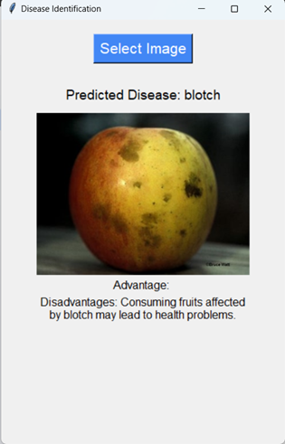
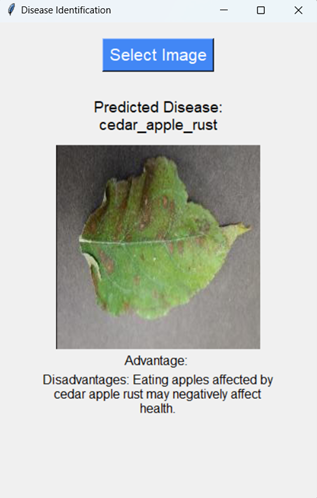
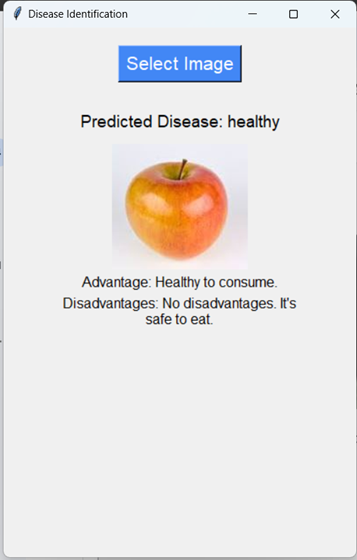

# Fruit Disease Detection with VGG-16

A transfer-learning classifier that sorts apple images into four diseases and a healthy class. The method is published in the IEEE ICCCIS 2023 paper included in this repository.


## Publication

**Detecting Fruit Diseases Using Deep Learning and Image Analysis**
T. Pareek, D. Dobariya, T. Mahajan, D. Bhise
2023 International Conference on Computing, Communication, and Intelligent Systems (ICCCIS), IEEE

[Read the paper (PDF)](./ICCCIS_Detecting%20Fruit%20Diseases%20using%20Deep%20Learning%20and%20Image%20Analysis.pdf)


## Dataset

| Split | Images |
|---|---|
| Training | 8,057 |
| Validation | 5,993 |
| Total | 14,050 |

Five classes: `apple_scab`, `black_rot`, `blotch`, `cedar_apple_rust` and `healthy`. Images are resized to 224 × 224 pixels and scaled to [0, 1]. The dataset is not part of this repository; the notebook reads it from Google Drive through the `traindir` and `validdir` paths.

## Model

```
Input (224 × 224 × 3)
  ↓
VGG-16 convolutional base, ImageNet weights, frozen   14,714,688 parameters
  ↓
Flatten
  ↓
Dense(5, softmax)                                         125,445 trainable parameters
```

Only the output layer is trained. The VGG-16 base keeps its ImageNet weights.

## Training

- Augmentation on the training images: shear 0.2, zoom 0.2, width and height shift 0.2
- Adam optimiser, categorical cross-entropy, batch size 128, 5 epochs
- Trained on Google Colab with a GPU

## Results

| Epoch | Training accuracy | Validation accuracy | Validation loss |
|---|---|---|---|
| 1 | 57.2% | 94.9% | 0.210 |
| 2 | 88.3% | 95.0% | 0.205 |
| 3 | 91.9% | 96.7% | 0.133 |
| 4 | 93.8% | 96.0% | 0.147 |
| 5 | 93.8% | 97.1% | 0.112 |

Training accuracy is measured on augmented images and averaged over each epoch, which is why it stays below validation accuracy. The notebook also plots the accuracy and loss curves and runs an example prediction on a single image.

## Limitations

- The validation set is used both to watch training and to report accuracy. There is no separate test evaluation.
- The VGG-16 base is never unfrozen, so the network is not fine-tuned.
- The per-class evaluation cell (confusion matrix and classification report) has no stored output yet. Run it after training to get per-class scores.

## Demo app

Screenshots of a small desktop demo that loads an image and shows the predicted class:

<p>
  
  
  
</p>

## Repository structure

```
├── FDD_Final.ipynb                 Data loading, training, curves, evaluation, example prediction
├── ICCCIS_Detecting Fruit ... .pdf IEEE ICCCIS 2023 paper
├── Untitled Diagram.drawio.png     Pipeline diagram
├── Picture1.png – Picture3.png     Demo app screenshots
└── README.md
```

## How to run

1. Clone the repository:
   ```bash
   git clone https://github.com/DeepDobariya307/Fruit-Disease-Detection-using-ML.git
   ```
2. Install the dependencies:
   ```bash
   pip install tensorflow numpy pandas matplotlib seaborn scikit-learn
   ```
3. Put the training and validation images in one folder per class, and set `traindir` and `validdir` in the notebook to those folders.
4. Run `FDD_Final.ipynb` in Google Colab (GPU runtime) or Jupyter.

## Author

**Deep Prakashbhai Dobariya**, M.Sc. Artificial Intelligence, BTU Cottbus-Senftenberg
[GitHub](https://github.com/DeepDobariya307) · [LinkedIn](https://www.linkedin.com/in/deep-dobariya-946816221/)

## License

For academic and research use. The images come from publicly available agricultural image collections.
